  

  
  
  
  

## Über mich

Ich studiere und entwickle neben der Uni eigene Software. Was meine Projekte verbindet: Man kann ihnen bei der Arbeit zusehen und selbst eingreifen – Partikel, die sich vor- und zurückspulen lassen, ein EKG, das man stört und wieder filtert, oder ein Spielabend, bei dem zwölf Leute um eine Kiste sitzen.

- **Zuletzt** – den Editor von Particle Playground fürs Handy umgebaut
- **Als Nächstes** – neue Labore für MedLab Studio: Wearable-Sensordaten und Arzneimittelspiegel
- **Nebenbei** – Spielmodi und Addons in Lua für Garry’s Mod und nanos world
- **Wie ich arbeite** – Tests für die Kernlogik, Commits mit Begründung, Grenzen direkt in der Oberfläche

## Projekte

  
  

  
  

  
  

## Womit ich arbeite

## Auf GitHub

## Kontakt

  
  
  

Banner, Karten und Statistik sind selbst gezeichnet – ohne fremde Dienste; die Statistik aktualisiert sich täglich. <a href="scripts/">So entsteht das hier.</a>

