  

  
  
  
  

## About me

I’m a student and build my own software alongside university. What my projects have in common: you can watch them work and step in yourself – particles you can rewind, an ECG you can disturb and filter clean again, or a game night with twelve people gathered around a box.

- **Recently** – won 1st place at the nanos world Halloween Game Jam 2026 with Jack’s Last Show, and rebuilt the Particle Playground editor for mobile
- **Right now** – Ward Zero, a Tokyo Ghoul roleplay server for nanos world, with its own Discord control center and animation pipeline
- **Up next** – new labs for MedLab Studio: wearable sensor data and drug levels
- **On the side** – Lua game modes and addons for Garry’s Mod and nanos world, and a trading AI that only ever runs on a demo account
- **How I work** – tests for the core logic, commits that explain why, limits shown right in the UI

## Awards

## Projects

  
  

  
  

  
  

## Currently building

These repositories are private, so the cards show what’s inside instead of linking to the code. Curious? Ask me on Discord.

  
  

  
  

## What I work with

## On GitHub

## Contact

  
  
  

Banner, cards and stats are drawn by my own scripts – no third-party services; the stats update daily. <a href="scripts/">How this is made.</a>

